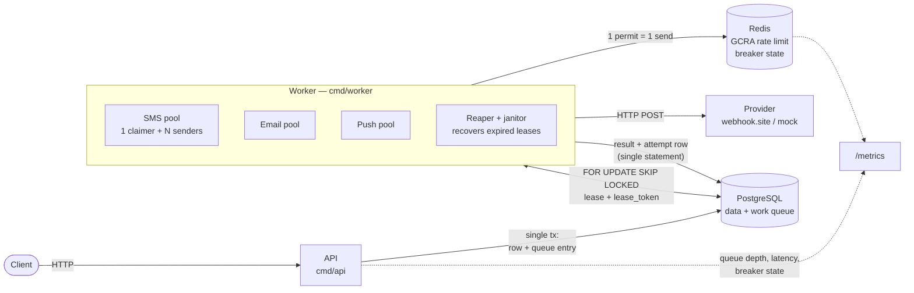

# Event-Driven Notification System

[](https://github.com/XENWRLD/insider-notification-system/actions/workflows/ci.yml)

A Go service that accepts notification requests over HTTP and delivers them through SMS,
email and push channels. PostgreSQL is both the data store and the durable work queue
(`FOR UPDATE SKIP LOCKED`); a separate worker process drains it with one goroutine pool
per channel, a Redis-backed global rate limit of 100 messages/second per channel, a
per-channel circuit breaker and lease-based crash recovery. Every request carries a
correlation ID from the API through the database into the worker logs.

> **A note on language.** This README and [docs/DESIGN.md](docs/DESIGN.md) are in
> English. The rest of the repository is in Turkish, the author's working language: code
> comments (which explain *why*, not *what*), the OpenAPI descriptions, API error
> messages, commit message bodies and `docs/PLAN.md`. Machine-readable parts are
> language-neutral — `error` codes, field names and statuses are English identifiers.

## Quick start

```bash
git clone https://github.com/XENWRLD/insider-notification-system.git
cd insider-notification-system
cp .env.example .env          # or: make env
docker compose up --build -d  # postgres + redis + migrate + api + worker + mock provider
```

Send one notification and watch it get delivered:

```bash
curl -i -X POST localhost:8080/api/v1/notifications \
  -H 'Content-Type: application/json' \
  -d '{"channel":"sms","recipient":"+905551234567","content":"Flash sale starts now","priority":"high"}'
# → 202 Accepted, Location: /api/v1/notifications/<id>, X-Correlation-ID: <id>

curl -s localhost:8080/api/v1/notifications/<id> | jq '.status, .attempts'
# → "sent", [ { "attempt_no": 1, "status_code": 202, "duration_ms": 51, ... } ]
```

| What | Where |
|---|---|
| Swagger UI | <http://localhost:8080/docs> |
| OpenAPI spec | <http://localhost:8080/openapi.yaml> |
| Metrics (Prometheus) | <http://localhost:8080/metrics> |
| Health | <http://localhost:8080/health/live>, <http://localhost:8080/health/ready> |
| Mock provider stats | <http://localhost:8081/stats> |

Everything else: `make help`. Tests: `make test` (needs Docker) or `make test-unit`.

## Architecture



Four invariants hold this together:

1. **The row and its queue entry are written in one transaction.** There is no outbox
   and no dual-write window: if the API returns `202`, the work is queued.
2. **A claimed row is owned by exactly one worker for a bounded window.** Claiming sets
   `status='processing'`, a `lease_token` and `lease_expires_at`; results are only
   accepted with a matching token, so a late zombie worker cannot overwrite a newer
   attempt.
3. **The claimer only pulls as much work as it has idle senders** (token semaphore), so
   held leases never exceed `WORKER_CONCURRENCY` and a row's claim→result window is a
   single wave (`rate wait + provider timeout + result write`).
4. **A permit is taken immediately before the provider call**, so one permit always
   equals one real send.

Details and rejected alternatives: [docs/DESIGN.md](docs/DESIGN.md).

## Requirement coverage

Mapped one-to-one against the assessment brief.

### 1. Notification Management API

| Requirement | Where |
|---|---|
| Create with recipient, channel, content, priority | `POST /api/v1/notifications` — `internal/httpapi/notifications.go` |
| Batch creation up to 1000 per request | `POST /api/v1/notifications/batch` — one transaction, `pgx.CopyFrom`, all-or-nothing |
| Query status by ID or batch ID | `GET /api/v1/notifications/{id}`, `GET /api/v1/batches/{id}` |
| Cancel pending notifications | `POST /api/v1/notifications/{id}/cancel` — single atomic `UPDATE`, `409` once sending started |
| List with filtering (status, channel, date range) and pagination | `GET /api/v1/notifications` — opaque cursor, `limit` ≤ 100 |

### 2. Processing Engine

| Requirement | Where |
|---|---|
| Asynchronous queue workers | `cmd/worker` + `internal/worker` — one pool per channel, PostgreSQL `SKIP LOCKED` queue |
| Rate limiting: 100 msg/s per channel | `internal/ratelimit` — GCRA bucket in Redis, shared by every replica |
| Priority queue (high, normal, low) | `priority_rank` generated column; claim orders by `(priority_rank, available_at, id)` |
| Content validation (character limits, required fields) | `internal/domain/validation.go` — per-channel rules, all field errors in one response |
| Idempotency to prevent duplicate sends | `Idempotency-Key` header + `idempotency_keys` table (key, request hash, stored response) |

### 3. Delivery & Retry Logic

| Decision | Behaviour |
|---|---|
| Classification | `internal/worker/classify.go` — 2xx → `sent`; 400/422 and unknown 4xx → `failed`; 401/403/404 → breaker (configuration fault, messages are valid); 429 → honours `Retry-After` and **does not** consume an attempt; 5xx/timeouts → retry |
| Backoff | `jitter(min(2s × 2^(n-1), 5m))`, up to 5 attempts; the worker never sleeps on a row — it sets `status='retrying'` and `available_at` |
| Circuit breaker | Per channel (`sony/gobreaker`); while open, that channel stops claiming, so messages burn neither attempts nor rate-limit permits |
| Crash recovery | Lease + reaper: expired leases return to `retrying`, or `failed` once attempts are exhausted |
| Delivery guarantee | At-least-once. Exactly-once is not available from an external provider; the notification ID is sent as the provider-side idempotency key |

### 4. Observability

| Requirement | Where |
|---|---|
| Real-time metrics (queue depth, success/failure rates, latency) | `GET /metrics` — `notifications_queue_depth`, `notifications_deferred_depth`, `notifications_terminal_recent`, `notification_end_to_end_duration_seconds`, `notification_provider_duration_seconds`, `notifications_breaker_state` |
| Structured logging with correlation IDs | `log/slog` JSON everywhere; the ID is stored on the row so worker logs carry the API's ID |
| Health check endpoint | `/health/live` (no dependencies touched) and `/health/ready` (PostgreSQL + Redis) |

### Deliverables

| Deliverable | Status |
|---|---|
| Source code with clean commit history | Conventional commits, one commit per completed step |
| README: setup, architecture, API examples | This file |
| Docker Compose one-command setup | `docker compose up --build` — migrations run as their own service |
| Swagger / OpenAPI specification | `api/openapi/openapi.yaml`, embedded in the binary, served at `/openapi.yaml` and `/docs` |
| Versioned database migrations | `migrations/` (golang-migrate, 5 pairs), applied by the `migrate` compose service |
| Test suite runnable with a single command | `make test` |

### Bonus features

| Bonus | Status |
|---|---|
| Failure handling | **Done** — classification, backoff with jitter, per-channel breaker, lease recovery, attempt history |
| Scheduled notifications | **Done** — optional `send_at`; no extra column, it reuses `available_at` |
| GitHub Actions CI/CD | **Done** — lint + `go test -race` with testcontainers on every push |
| Template system | Not implemented (deliberate — see below) |
| WebSocket updates | Not implemented (deliberate) |
| Distributed tracing | Not implemented (deliberate) |

Scope was spent on the depth of the core engine instead: each of the three skipped
bonuses is a feature surface, while rate limiting, retry classification and lease
recovery are where the correctness arguments live.

## API examples

Batch, with idempotency protection:

```bash
curl -s -X POST localhost:8080/api/v1/notifications/batch \
  -H 'Content-Type: application/json' \
  -H 'Idempotency-Key: campaign-42' \
  -d '{"notifications":[
        {"channel":"sms","recipient":"+905551234567","content":"Breaking news","priority":"high"},
        {"channel":"email","recipient":"user@example.com","content":"Your order shipped"}
      ]}'
# → 202 { "batch_id": "...", "accepted_count": 2, "notification_ids": [...] }
# Same key + same body again → 202 with the stored response and Idempotent-Replay: true
# Same key + different body  → 409 conflict

curl -s localhost:8080/api/v1/batches/<batch_id>
# → { "total": 2, "counts": { "sent": 2, "pending": 0, ... }, "completed": true }
```

Filtering and pagination (same parameter repeated = OR, different parameters = AND):

```bash
curl -s "localhost:8080/api/v1/notifications?status=failed&status=retrying&channel=sms&limit=20"
# → { "notifications": [...], "next_cursor": "MjAyNi0xMS0yNV..." }
curl -s "localhost:8080/api/v1/notifications?cursor=MjAyNi0xMS0yNV..."
```

Scheduling and cancelling:

```bash
curl -s -X POST localhost:8080/api/v1/notifications \
  -H 'Content-Type: application/json' \
  -d '{"channel":"sms","recipient":"+905551234567","content":"Tomorrow 09:00",
       "send_at":"2026-12-01T09:00:00+03:00"}'
# Stays pending until send_at, so it can still be cancelled:
curl -s -X POST localhost:8080/api/v1/notifications/<id>/cancel
```

Validation errors arrive field by field, in a single response:

```json
{
  "error": "validation_failed",
  "message": "istek doğrulanamadı",
  "fields": {
    "notifications[3].recipient": "E.164 biçiminde olmalı (örn. +905551234567)",
    "notifications[7].content": "GSM-7 SMS en fazla 160 septet olabilir (184 hesaplandı)"
  },
  "correlation_id": "4f1c2b8e-9a3d-4c7f-8f21-2b6d0c5a7e13"
}
```

Every error response — including 404 and 405 — uses this envelope and always carries
`correlation_id`. Message strings are Turkish; the machine-readable `error` code is the
contract (`internal/httpapi/errors.go` is its single source, and a test keeps the
OpenAPI enum in sync). RFC 9457 (`application/problem+json`) was deliberately not used:
the flat envelope needs no extra media type or schema on the client side and hands field
errors over as a map that binds straight to a form.

### Validation rules

| Channel | Recipient | Content |
|---|---|---|
| `sms` | E.164 (`+905551234567`) | 160 septets if GSM-7 encodable, otherwise **70 UTF-16 code units** |
| `email` | A bare address, ≤ 254 chars (`Ali <a@b.com>` is rejected) | ≤ 10,000 characters |
| `push` | Device token without whitespace, ≤ 512 chars | ≤ 512 characters |

The SMS rule follows the real GSM 03.38 table, which has a consequence worth knowing
for Turkish content: lower-case `ç` and `ş ğ ı İ` are **not** in the table while
upper-case `Ç` and `ö ü Ö Ü` are. A single `ş` therefore drops the limit from 160 to 70,
and the same text in upper case may pass where the lower-case version does not. An emoji
costs 2 units. The error message says which encoding was applied, because otherwise
"why 70?" is unanswerable. Content consisting only of whitespace counts as empty, and
unknown JSON fields are rejected rather than silently ignored.

## Design decisions

Each decision as *choice → why → trade-off*. The long versions, including the
alternatives that were measured and rejected, are in [docs/DESIGN.md](docs/DESIGN.md).

| Decision | Why | Trade-off |
|---|---|---|
| **PostgreSQL as the queue** (`FOR UPDATE SKIP LOCKED`) | The row and the queue entry commit together — no outbox, no dual-write window, one fewer piece of infrastructure | Throughput ceiling is a single primary's write capacity; the migration path to Kafka/RabbitMQ is described in DESIGN |
| **One pool per channel** | Head-of-line blocking is structural: a stalled SMS provider cannot delay email | More goroutines and more DB connections than a shared pool |
| **Rate limit in Redis (GCRA), not in-process** | `--scale worker=3` must not triple the rate; the limit belongs to the bucket, not the process | Redis is on the send path; it is **fail-closed** (no permit → no send) |
| **Permit taken in the sender, not before claiming** | One permit = one real send; permits taken before a claim burn when the claim returns fewer rows (5 msg/s traffic would throttle against a 100/s limit) | A row waiting for a permit is `processing`, so it cannot be cancelled during that window (typically ~0.6 s) |
| **Lease + `lease_token` + reaper, no lease renewal** | The worst-case send window is bounded and checked at boot (`lease ≥ 2 × (rate wait + provider + result)`), so renewal adds machinery without removing a risk | A crashed worker's row waits out the lease (≤ 60 s) before being retried |
| **Breaker is local per replica, rate limit is shared** | A counter is commutative and fits one Redis key; "5 consecutive failures" needs event ordering across replicas, which is distributed consensus | At the start of an outage each replica burns ~threshold-1 attempts, and `/metrics` can show different states per replica |
| **Single `available_at`** for normal, retried and scheduled sends | One mechanism, one index, one claim query — scheduling needed no new column and no migration | After the first retry the originally requested time is no longer readable |
| **Idempotency hash over raw body bytes** | Real retries resend identical bytes; it keeps "same request" from depending on the server's JSON interpretation | Semantically identical but byte-different requests (extra whitespace, reordered keys) get `409` |
| **`202 Accepted`, not `201 Created`** | The row exists but nothing has been delivered yet; `sent` means the provider accepted, not that the user received it | Clients that expect a creation code need a one-line adjustment |
| **Metrics derived from the database, exposed only by the API** | Three worker replicas exposing their own ports means three scrape targets and merge logic; the database is already the single source of truth | Values are **gauges**, not counters, so `rate()` does not apply (the metric names say so) |
| **Hand-written SQL, no ORM** | The claim query is the core of the system and its plan is part of the design; every index decision was made with `EXPLAIN` | More code to maintain by hand |
| **Validation in the domain layer** | Transport stays dumb; database `CHECK` constraints are the second line of defence | Rules are stated twice, deliberately |

## Measurements

Numbers from the local stack (Docker Desktop, PostgreSQL 18, Redis 8, mock provider at
50 ms latency), not estimates.

| Scenario | Result |
|---|---|
| 1000 SMS, 1 worker, limit 100/s | **12.1 s**, peak 98 sends/s — the limit is never exceeded |
| Same batch, `--scale worker=3` | **10.9 s**, exactly 96/s every full second — throughput does **not** scale, which is the point of a shared bucket; provider requests total 1000 (no duplicates) |
| Channel isolation | 562 SMS still queued while 5 emails completed in **1.09 s** |
| Worker engine without rate limiting | 1000 SMS in **7.7 s** |
| Latency split | end-to-end p50 **1.65 s** vs provider call p50 **0.021 s** → the delay is queueing and throttling, not the provider |
| Breaker, 200-row batch, `failure_rate=1` | **0 failed**, 4 rows at `attempt_count=1` (threshold-1), 179 never claimed, and only **8 provider requests instead of 200** — the breaker stops the bleeding. After `failure_rate=0`: 200/200 `sent`, 208 requests total |
| Permanent 429, 50 notifications over 60 s | **0 failed**, **0 attempts consumed**, `last_error` carries the 429 — but 2150 provider requests of queue churn (the honest cost; the fix is lowering `RATE_LIMIT_PER_SECOND`) |
| Cursor index decision (100k rows, 20 `failed`) | `Seq Scan` 13.77 ms → `Index Scan` **0.13 ms** (migration `000004`) |
| Queue-depth query (20k terminal + 50 active rows) | `Index Scan`, 18 buffers — cost follows active rows, not table size |
| Scheduled delivery | A notification scheduled 30 s ahead stayed `pending` and was sent **153 ms** after its target |
| Graceful shutdown under load | Worker stopped with a 300-row batch in flight: **0 ERROR** log lines, 303 `sent` after restart, **0** rows stuck in `processing` |

Sample `/metrics` output:

```
notifications_queue_depth{channel="sms",status="pending"} 248
notifications_queue_depth{channel="sms",status="processing"} 20
notifications_deferred_depth{channel="sms",status="pending"} 1
notifications_terminal_recent{channel="sms",status="sent"} 432
notification_end_to_end_duration_seconds{quantile="0.5"} 3.202188999
notification_provider_duration_seconds{quantile="0.5"} 0.051
notifications_breaker_state{channel="sms",worker="73684071febf"} 0
notifications_metrics_collect_errors 0
```

Read that sample as a story: 248 rows are ready to send and 20 are in flight (one
replica, `WORKER_CONCURRENCY=20`), one row is scheduled for later rather than stuck,
432 went out in the last 15 minutes, and the 3.2 s end-to-end p50 against a 51 ms
provider call says the queue — not the provider — is where the time goes.

## Using webhook.site as the provider

The brief asks for webhook.site as the simulated provider. The compose stack points the
worker at the bundled mock provider by default, because a free webhook.site URL is
limited to **100 requests / 7 days** and a single load test would exhaust it.

To demo against webhook.site:

1. Open <https://webhook.site> and copy your unique URL.
2. In the site's **Edit** dialog set the response to status `202`, content type
   `application/json`, and body:
   ```json
   { "messageId": "11111111-2222-3333-4444-555555555555", "status": "accepted", "timestamp": "2026-12-01T09:00:00Z" }
   ```
3. Put the URL in your local `.env` (never in `.env.example`, which is committed):
   ```bash
   WORKER_PROVIDER_URL=https://webhook.site/<your-uuid>
   ```
4. `docker compose up -d worker` and send a notification per channel. The request body
   the provider receives is exactly the format in the brief:
   ```json
   { "to": "+905551234567", "channel": "sms", "content": "Your message" }
   ```

Any 2xx counts as acceptance, not just `202`: webhook.site's default response is `200`,
and treating that as a failure would have retried messages the provider had accepted.
If the body is not JSON the notification is still `sent` with a null
`provider_message_id` — the provider accepted it, so retrying would duplicate a
delivered message.

The mock provider (`cmd/mockprovider`) is the better tool for everything else: its
failure, rate-limit and bad-request rates plus latency are reconfigurable at runtime.

```bash
curl -X POST localhost:8081/config -d '{"failure_rate":0.3,"latency":"50ms"}'
curl -s localhost:8081/stats   # per-status-code and per-channel counters
```

## Known limits and deliberate choices

Things a reviewer should know before finding them. Each one is a decision, not an
oversight.

**Behaviour**

- **Low-priority starvation.** While high-priority traffic keeps arriving, low-priority
  rows can wait indefinitely: queue order is a single
  `ORDER BY priority_rank, available_at, id` that matches the claim index column for
  column. Aging (an age term in the sort key) would change that index and every plan
  decision built on it — not a change to make without load measurements. The behaviour
  is pinned by `TestClaimLeavesLowPriorityBehindWhileHighPriorityArrives`.
- **A row awaiting a rate-limit permit cannot be cancelled** (it is already
  `processing`), and the priority order freezes for that one wave. Typically ~0.6 s,
  worst case `WORKER_RATE_WAIT_MAX`.
- **At-least-once delivery.** If the provider accepts a message and the worker dies
  before writing the result, the reaper re-sends it after the lease expires. The
  notification ID travels as the provider-side idempotency key so a well-behaved
  provider can deduplicate.
- **A scheduled notification's original target time is lost after its first retry**,
  because `available_at` then moves to the backoff time. A second column would mean two
  sources for "when should this go"; the first attempt's timestamp remains in
  `notification_attempts`.
- **Rows handed back at shutdown look like `retrying` with `attempt_count = 0`.**
  `processing → pending` is forbidden by the state machine, so the row lands in
  `retrying`, but since no attempt was made the counter is rolled back.
- **A failed lease hand-back can cost an attempt.** If the `UPDATE` that returns a lease
  fails (for example a pool timeout during a release storm), the row keeps its
  incremented `attempt_count` and the reaper counts it as an attempt even though the
  provider was never called. Fixing this properly needs a "did we call the provider"
  marker, a migration and a reaper change; with 5 attempts and jittered backoff the
  exposure is small, so it is documented rather than patched.
- **Permanent 429 produces queue churn** rather than lost messages: 50 notifications
  generated 2150 provider requests over 60 s. The right response is lowering
  `RATE_LIMIT_PER_SECOND` to match the provider's real budget.
- **The circuit breaker is per replica**, so `/metrics` can legitimately show `open` on
  one worker and `half-open` on another, and each replica burns up to threshold-1
  attempts when an outage starts.

**Operational**

- **`WORKER_CONCURRENCY` must be sized against the rate limit.** Under throttling,
  senders hold leases while waiting for permits: `rate=1/s` with `concurrency=20` would
  hold 20 rows hostage for 20 s. Healthy relation:
  `concurrency ≈ rate × (provider latency + result write)` plus headroom. Repeated
  "izin beklemesi aşıldı" warnings mean this setting is wrong.
- **The documented 16 MiB batch body is not reachable over a slow link.** `ReadTimeout`
  is 15 s and covers body reading, which implies roughly 8.7 Mbit/s of client bandwidth.
  Raising only `ReadTimeout` would not help either, because `WriteTimeout` starts
  counting when the request headers are read; opening both would weaken slow-client
  protection. Large batches belong on fast links, or should be split.
- **Metrics are gauges, not counters** (`notifications_terminal_recent` is a 15-minute
  window): a cumulative count was measured and rejected because the planner chose a
  `Seq Scan` for it, making scrape cost grow with table size.
- **`/metrics` is unauthenticated**, like the rest of the API. It is protected against
  cost instead: a 5 s cache, singleflight so concurrent scrapes share one query round,
  a 2 s timeout per query, and at most 4 in-flight requests.
- **No authentication anywhere** (the spec declares `security: []`). In production this
  service belongs behind a gateway.
- **Swagger UI assets come from a pinned CDN version with SRI hashes.** With no internet
  access `/docs` renders blank, but `/openapi.yaml` is always served from the binary.
  Vendoring ~2 MB of minified JavaScript was the alternative.
- **Batch limits apply together:** 1000 items *and* 16 MiB. Long Turkish or emoji-heavy
  email batches can hit the byte limit before the item limit.
- **Cursors are opaque.** Pass back only the `next_cursor` from the previous response;
  the internal format may change. Date ranges are half-open `[from, to)` and require a
  timezone, so consecutive windows never double-count a boundary row.

## Testing

```bash
make test        # everything; testcontainers spins up PostgreSQL and Redis (needs Docker)
make test-unit   # -short: no Docker required
make test-race   # race detector
make lint        # golangci-lint
```

CI runs lint and `go test -race ./...` — including the testcontainers integration
tests — on every push. Tests live next to the code they cover (`foo.go` → `foo_test.go`).

Beyond the usual unit coverage, these tests exist because the invariants they protect
are easy to break silently:

- **Two workers never claim the same row** and concurrent claims partition the queue.
- **A late worker's result is rejected** when its `lease_token` no longer matches.
- **The rate limit is shared across limiter instances** — the test that proves
  `--scale worker=3` cannot triple the rate.
- **Query plans are asserted**, not assumed: the claim query must use the partial claim
  index, and the metrics queries must not fall back to `Seq Scan`. The `EXPLAIN` runs
  against the SQL the application actually builds.
- **The OpenAPI document cannot drift**: one test walks the chi router and compares it
  with the spec's paths, another compares response DTO JSON tags with the schema
  properties, and two more keep the error-code enum in sync with the Go constants
  (one of them parses `errors.go` with `go/parser`).
- **Shutdown is quiet**: a cancelled context must not produce database queries or
  misleading `ERROR` lines. Without the fix, 93 of 200 rounds queried with a dead
  context.

## Project layout

```
cmd/api           HTTP API process
cmd/worker        channel pools, claim/retry/reaper/janitor
cmd/mockprovider  configurable fake provider (failure rate, latency)
internal/domain   models, state machine, validation
internal/httpapi  router, middleware, handlers
internal/store    PostgreSQL queries (hand-written SQL)
internal/worker   pools, claim, send, classify, reaper
internal/provider external provider HTTP client
internal/ratelimit Redis GCRA bucket
internal/breaker  per-channel circuit breaker
internal/observability  logger, metrics collector
migrations        golang-migrate files (5 versions)
api/openapi       OpenAPI document, embedded into the binary
docs/DESIGN.md    long-form rationale
docs/PLAN.md      the working plan this was built from (Turkish)
```

## Configuration

Every setting has a documented default in [`.env.example`](.env.example) — read it as the
configuration reference; the comments carry the reasoning and the inequalities the worker
enforces at boot. The ones most worth knowing:

| Variable | Default | Note |
|---|---|---|
| `RATE_LIMIT_PER_SECOND` | `100` | Per channel, shared by all replicas: "at most this many in any 1-second window" |
| `RATE_LIMIT_BURST` | `5` | GCRA tolerance; chosen by measurement (burst 1 cost 20% throughput) |
| `WORKER_CONCURRENCY` | `20` | Also the maximum number of leases a replica can hold |
| `WORKER_LEASE_DURATION` | `60s` | Must cover `2 × (rate wait + provider + result)`; checked at boot |
| `WORKER_RETRY_BASE_DELAY` / `_MAX_DELAY` | `2s` / `5m` | `jitter(min(base × 2^(n-1), max))` |
| `WORKER_BREAKER_FAILURE_THRESHOLD` | `5` | Consecutive failures per channel; a success resets it |
| `BODY_LIMIT_SINGLE` / `BODY_LIMIT_BATCH` | 128 KiB / 16 MiB | Per-endpoint body limits |
| `WORKER_PROVIDER_URL` | mock provider | Point this at your webhook.site URL for the real-provider demo |
